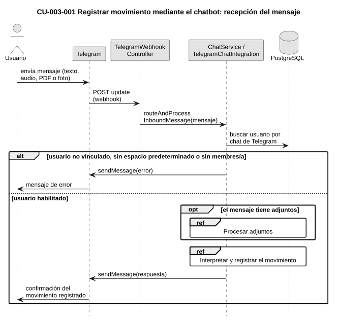
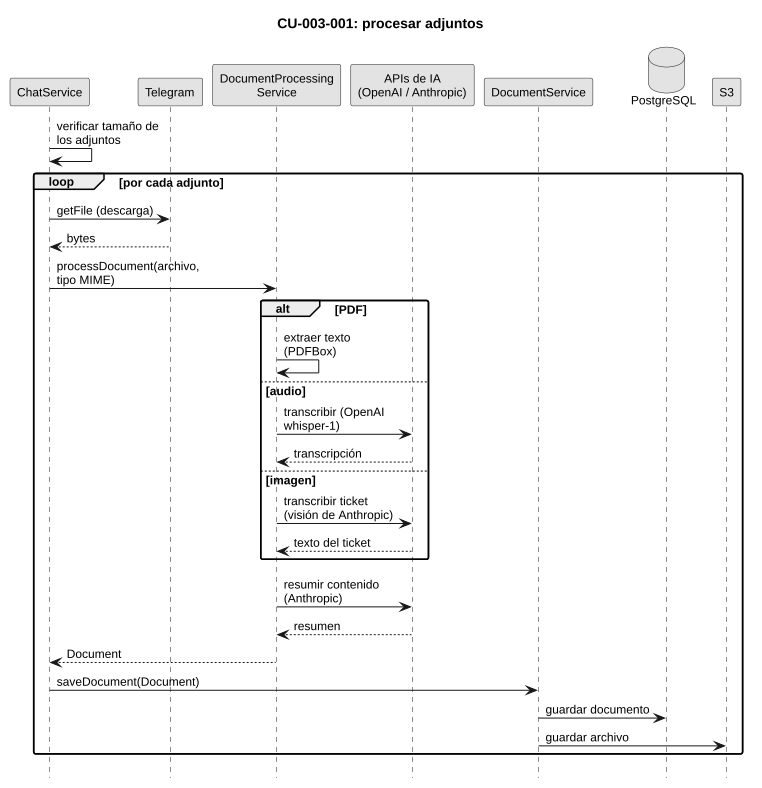
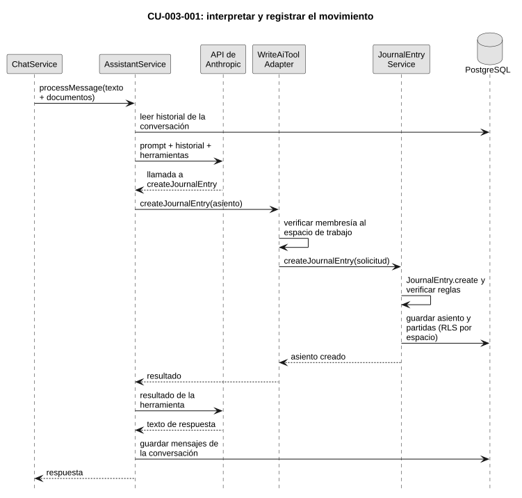
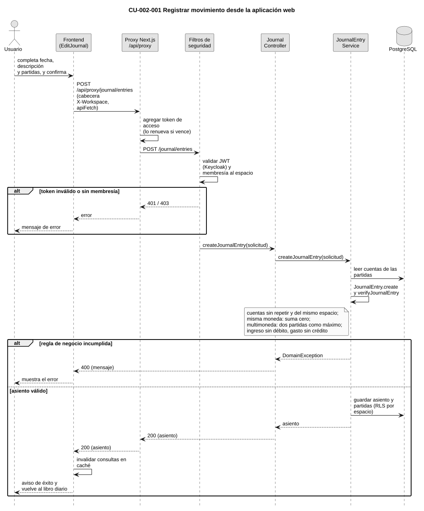
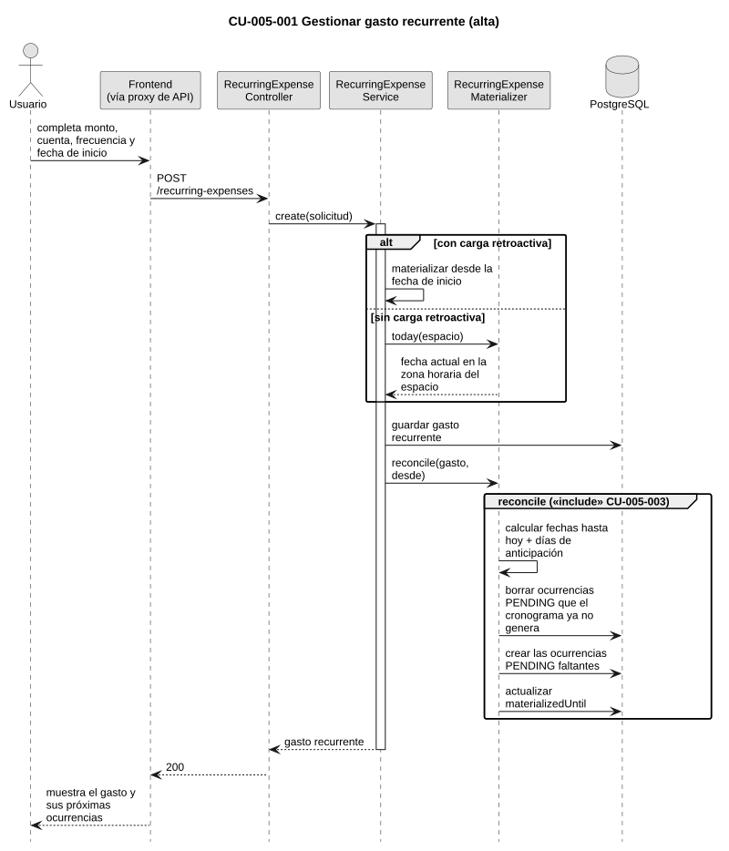
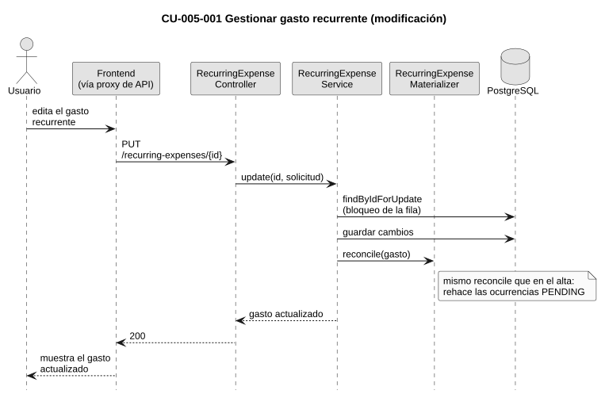
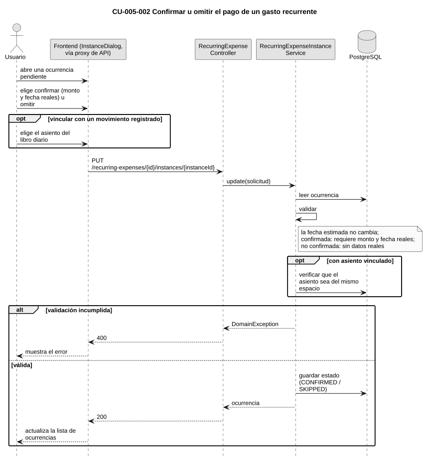
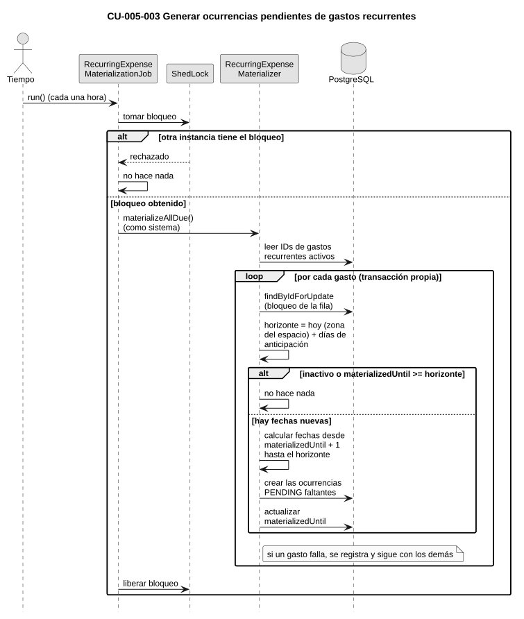

# 10.5.4 Diagrama de secuencia

> [!quote] Consigna
> [Descripción: Diagrama de secuencia del Caso de Uso]

## Qué se espera

Diagramas de secuencia de los casos de uso (al menos de los principales).

## Ideas y material disponible

- Criterio del profesor: el diagrama se hace sobre los 4 casos de uso core (ver [[10.5.3 Casos de uso]]).
- Guardar los diagramas exportados en `imagenes/` (por ejemplo, desde PlantUML, Mermaid o draw.io, conservando también el archivo fuente).

## Ejemplos

- (sin aportes por ahora)

## Preguntas abiertas y observaciones

- Diagramas derivados del código (backend y frontend) al 13/11/2026. Fuentes en `imagenes/diagramas/*.puml`; se regeneran con `herramientas/diagramas.sh`.
- En CU-002-001, "Filtros de seguridad" agrupa Spring Security (validación del JWT) y `WorkspaceAuthenticationFilter` (cabecera X-Workspace y membresía vía `UserWorkspaceCache`).
- Falta el diagrama del CU-008-001 (alerta de inflación), que todavía no está implementado.

## Respuesta

<!-- Todo lo que esté debajo de este título es el texto que se compila al documento final. -->

Los siguientes diagramas muestran cómo colaboran los componentes de la solución en los casos de uso core. Los nombres de los participantes corresponden a las clases de la implementación. El registro por chatbot se divide en tres diagramas: la recepción del mensaje y los dos fragmentos que referencia (procesar adjuntos e interpretar y registrar el movimiento).

