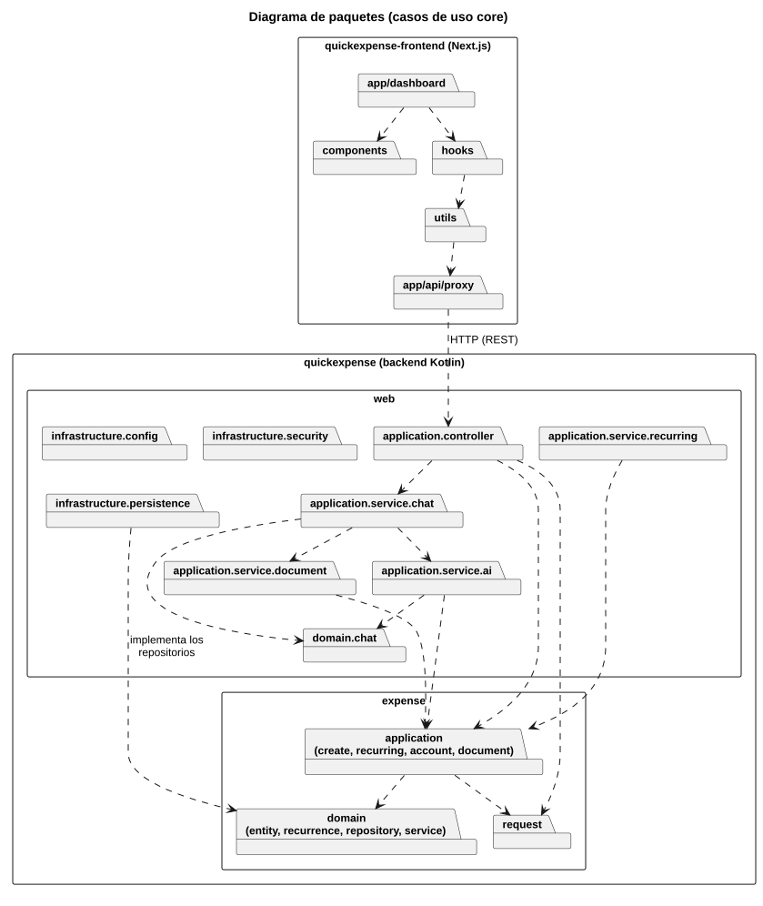

# 10.5.5 Diagrama de paquetes

> [!quote] Consigna
> [Descripción: Muestra cómo se divide un sistema en agrupaciones lógicas mostrando las dependencias entre dichas agrupaciones]

## Qué se espera

Agrupaciones lógicas del sistema y sus dependencias.

## Ideas y material disponible

- Criterio del profesor: el diagrama se hace sobre los 4 casos de uso core (ver [[10.5.3 Casos de uso]]).
- Guardar los diagramas exportados en `imagenes/` (por ejemplo, desde PlantUML, Mermaid o draw.io, conservando también el archivo fuente).
- Del código: dos módulos Gradle, `expense` (dominio y aplicación) y `web` (controladores, chat, IA, documentos, persistencia y seguridad), con capas `domain` / `application` / `infrastructure`.

## Ejemplos

- (sin aportes por ahora)

## Preguntas abiertas y observaciones

- Diagrama derivado del código al 13/11/2026 (`imagenes/diagramas/paquetes.puml`). Solo incluye los paquetes que intervienen en los casos de uso core 1 a 3.
- Falta revisar si el CU-008-001 (alerta de inflación) agrega paquetes cuando se implemente.

## Respuesta

<!-- Todo lo que esté debajo de este título es el texto que se compila al documento final. -->

El sistema se divide en dos aplicaciones: el *frontend*, en Next.js, y el *backend*, en Kotlin. El *backend* es un monolito modular con dos módulos de Gradle:

- `expense`, el núcleo de la solución: contiene el dominio (entidades, reglas de recurrencia e interfaces de los repositorios) y los servicios de aplicación que registran asientos y administran gastos recurrentes, sin depender de ningún *framework* web ni de la base de datos;
- `web`, que expone el núcleo hacia afuera: los controladores REST, la integración con Telegram, el asistente de IA, el procesamiento de documentos, la tarea programada, la seguridad y la persistencia.

Las dependencias van siempre de `web` hacia `expense`. La persistencia de `web` implementa las interfaces de repositorio que define el dominio. En el *frontend*, las páginas usan componentes y *hooks*, que llaman al *backend* a través del proxy de API.

