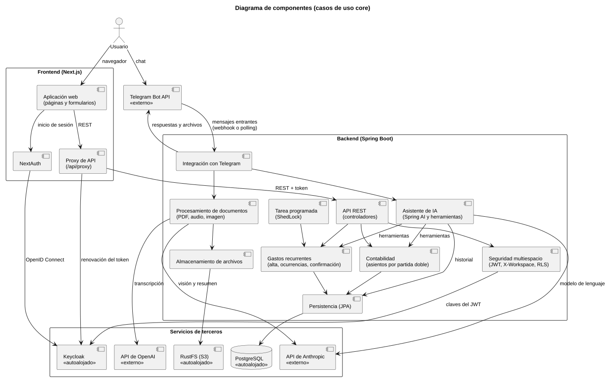

# 10.5.6 Diagrama de componentes

> [!quote] Consigna
> [Descripción: Se diagramarán todos los componentes que participan en la solución, esto permite observar fácilmente el alcance del desarrollo en un solo gráfico. Aquí se puede incluir componentes de terceros que pudieran utilizarse. Permite modelar los aspectos físicos del sistema]

## Qué se espera

Todos los componentes de la solución, incluidos los de terceros.

## Ideas y material disponible

- Criterio del profesor: el diagrama se hace sobre los 4 casos de uso core (ver [[10.5.3 Casos de uso]]).
- Guardar los diagramas exportados en `imagenes/` (por ejemplo, desde PlantUML, Mermaid o draw.io, conservando también el archivo fuente).
- Componentes de terceros conocidos: proveedor de LLM, API de Telegram, APIs de cotizaciones e inflación.
- Del código: frontend Next.js → API REST Spring Boot → PostgreSQL; Keycloak (autenticación); almacenamiento S3 (documentos); Telegram (webhook); Anthropic (asistente y resúmenes); OpenAI Whisper (transcripción).

## Ejemplos

- (sin aportes por ahora)

## Preguntas abiertas y observaciones

- Diagrama derivado del código al 13/11/2026 (`imagenes/diagramas/componentes.puml`). Solo incluye los componentes que intervienen en los casos de uso core 1 a 3; las APIs de inflación y cotización del dólar entran con el CU-008-001.
- Falta el CU-008-001 (alerta de inflación), que todavía no está implementado.

## Respuesta

<!-- Todo lo que esté debajo de este título es el texto que se compila al documento final. -->

El diagrama muestra los componentes que intervienen en los casos de uso core y los servicios de terceros que usan. Keycloak, PostgreSQL y el almacenamiento S3 (RustFS) son productos de terceros autoalojados en el servidor propio. Telegram, Anthropic y OpenAI son servicios externos a los que se accede por sus APIs.

{.apaisada}
