# 10.5.7 Diagrama de Clases de toda la solución

> [!quote] Consigna
> [Para una evaluación completa incluir el diagrama de clases de toda la solución]

## Qué se espera

Diagrama de clases completo.

## Ideas y material disponible

- Criterio del profesor: el diagrama se hace sobre los 4 casos de uso core (ver [[10.5.3 Casos de uso]]).
- Guardar los diagramas exportados en `imagenes/` (por ejemplo, desde PlantUML, Mermaid o draw.io, conservando también el archivo fuente).

## Ejemplos

- (sin aportes por ahora)

## Preguntas abiertas y observaciones

- Diagramas derivados del código al 13/11/2026.
- `User`, `UserSettings`, `UserSettingsService` y el diagrama de seguridad actualizados el 13/11/2026 según el cambio de usuarios en el código: se eliminaron el registro con contraseña (`/register`, `/login`, `CustomUserDetails`) y el correo de `UserSettings`; se agregaron `UserService` (en el módulo `expense`) y `AuthenticatedUserSyncFilter`.
- Falta agregar las clases del caso de uso core 4 (CU-008-001) cuando esté implementado.

## Respuesta

<!-- Todo lo que esté debajo de este título es el texto que se compila al documento final. -->

El diagrama de clases se limita a las clases que participan en los casos de uso core implementados (CU-003-001, CU-002-001 y CU-005-001/002/003), según el criterio de la cátedra de trabajar sobre los casos de uso core. Los nombres, atributos y métodos corresponden a la implementación en Kotlin y los paquetes coinciden con los del diagrama de paquetes. Los identificadores tipados (por ejemplo, `AccountId`) se muestran como tipo de los atributos, sin dibujar cada clase de identificador. Las clases del caso de uso core 4 (alerta de inflación) se agregarán cuando esté implementado. Se divide en diagramas de dominio y de capas de aplicación e infraestructura para que cada uno sea legible.

### Dominio

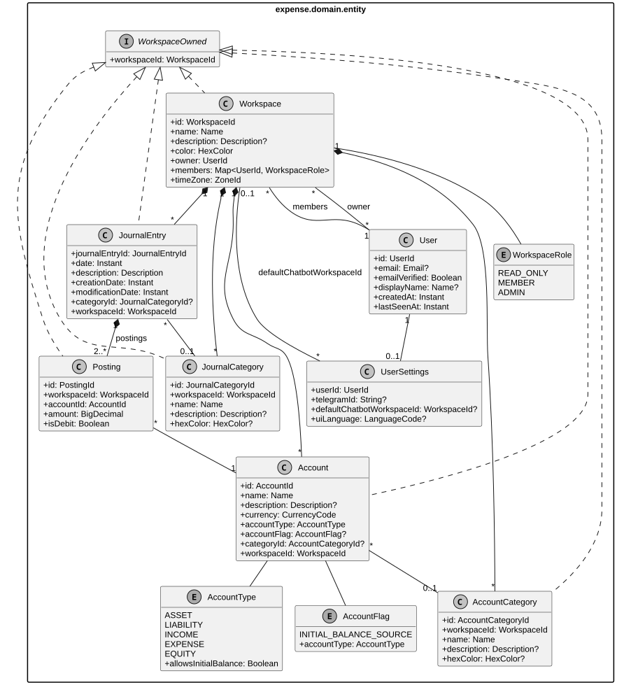

Toda entidad que pertenece a un espacio de trabajo implementa `WorkspaceOwned` y expone su `workspaceId`. Un `Workspace` tiene un propietario y miembros, cada uno con un `WorkspaceRole` (`READ_ONLY`, `MEMBER` o `ADMIN`), y agrupa las cuentas, las categorías de cuenta, las categorías de movimiento y los asientos. La contabilidad es de partida doble: un `JournalEntry` se compone de al menos dos `Posting`, y cada `Posting` se imputa a una única `Account` al débito o al crédito (`isDebit`) por un monto positivo. Una cuenta tiene un `AccountType`, una moneda, un `AccountFlag` opcional y una `AccountCategory` opcional, y un asiento puede tener una `JournalCategory`. `User` es la copia local de la identidad del usuario en Keycloak: su identificador es el del usuario en Keycloak y la aplicación no guarda contraseñas. `UserSettings` vincula al usuario con su identificador de Telegram y su espacio de trabajo por defecto del chatbot.

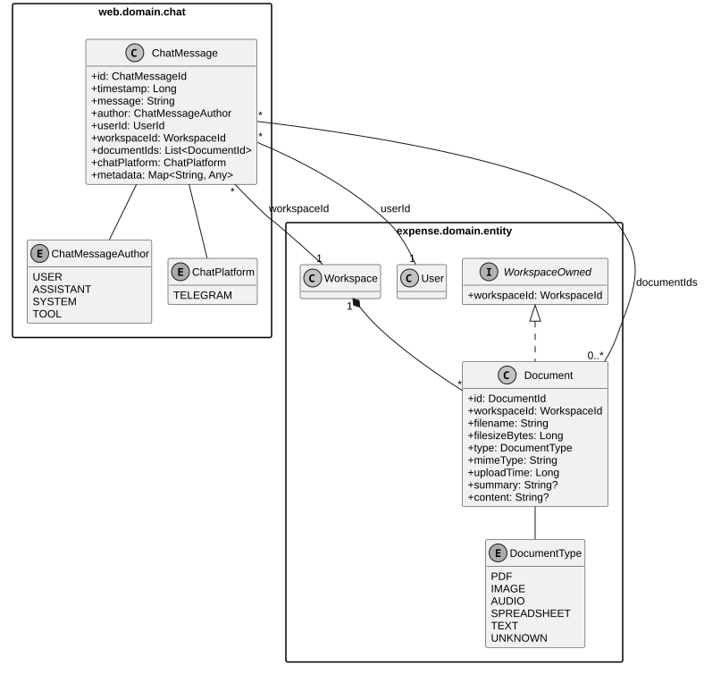

Un `Document` es un archivo adjunto del espacio de trabajo, con su tipo (`DocumentType`), el contenido extraído y un resumen. Un `ChatMessage` registra cada mensaje de la conversación entre un usuario y el asistente en un espacio de trabajo, con su autor (`ChatMessageAuthor`), la plataforma de chat y los documentos adjuntos.

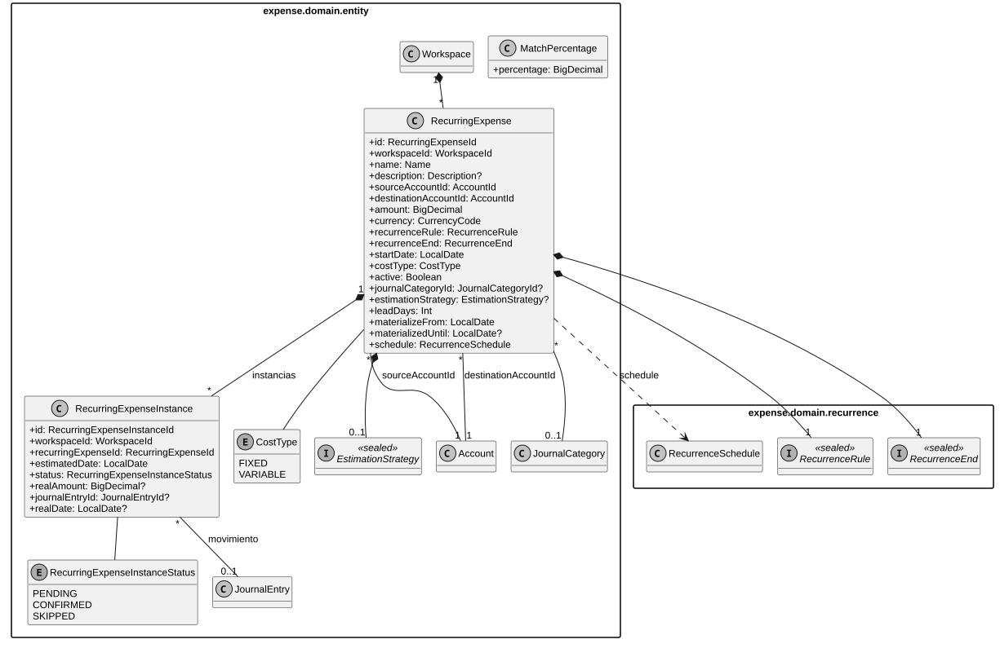{.apaisada}

Un `RecurringExpense` representa un pago periódico desde una cuenta de origen hacia una cuenta de destino, de costo fijo o variable (`CostType`); los de costo variable requieren una `EstimationStrategy`. Cada vencimiento se registra como un `RecurringExpenseInstance` con estado `PENDING`, `CONFIRMED` o `SKIPPED`; las ocurrencias confirmadas se asocian al `JournalEntry` que registra el pago real.

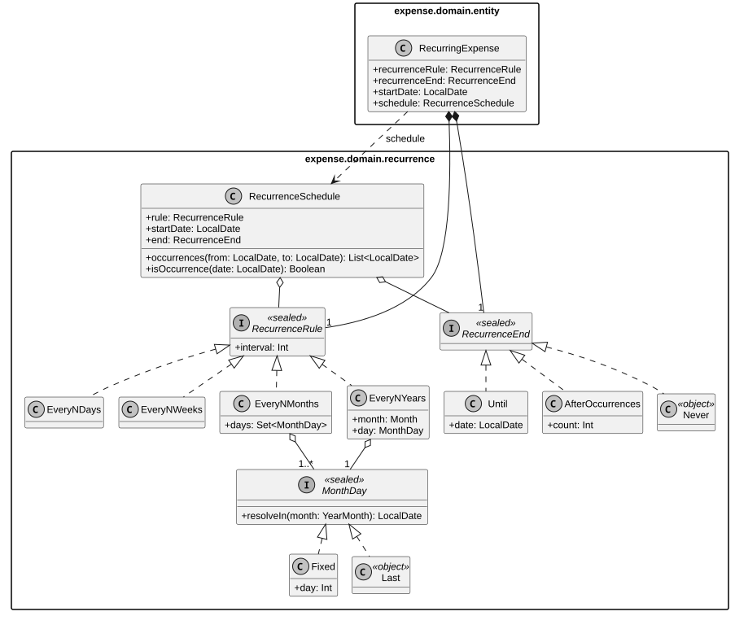

La periodicidad se modela con tipos sellados. `RecurrenceRule` admite las variantes `EveryNDays`, `EveryNWeeks`, `EveryNMonths` y `EveryNYears`; `RecurrenceEnd`, las variantes `Never`, `Until` y `AfterOccurrences`; y `MonthDay`, un día fijo o el último día del mes. `RecurrenceSchedule` combina la regla, la fecha de inicio y el fin, y calcula las fechas de ocurrencia en un intervalo.

### Aplicación e infraestructura

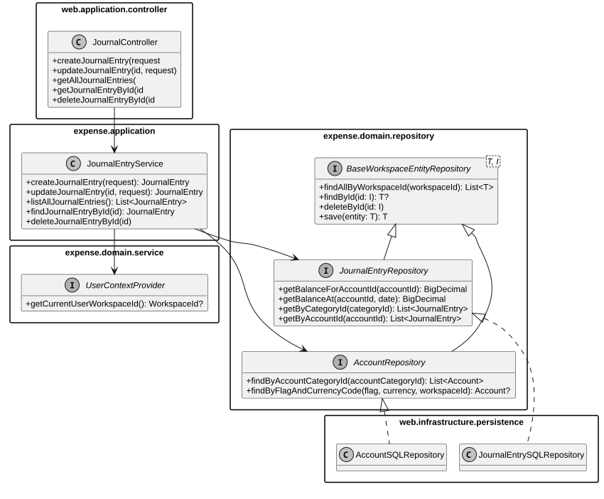

`JournalController` delega en `JournalEntryService` las operaciones sobre asientos. El servicio depende de los puertos `JournalEntryRepository` y `AccountRepository` (definidos en el dominio y derivados de `BaseWorkspaceEntityRepository`) y de `UserContextProvider` para conocer el espacio de trabajo actual; la persistencia se resuelve en las clases `*SQLRepository`, que realizan esos puertos.

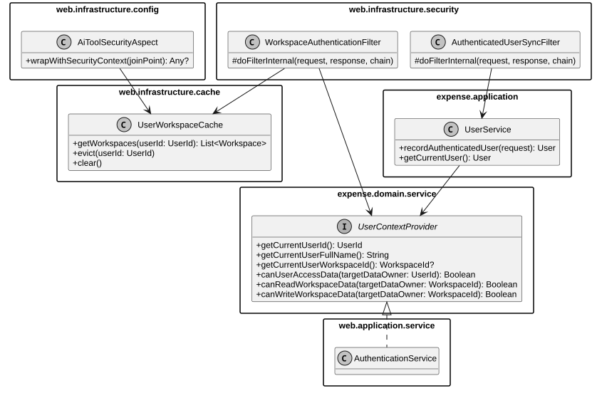

`AuthenticationService` realiza `UserContextProvider`. `WorkspaceAuthenticationFilter` valida en cada solicitud que el usuario pertenezca al espacio de trabajo indicado, consultando `UserWorkspaceCache`; `AiToolSecurityAspect` hace lo propio para las herramientas del asistente. `AuthenticatedUserSyncFilter` mantiene actualizada la copia local del usuario (`User`) con los datos del token emitido por Keycloak, a través de `UserService`; para no escribir en cada solicitud, solo lo hace cuando esos datos cambian o pasó un intervalo configurable, y un error en esta sincronización no interrumpe la solicitud.

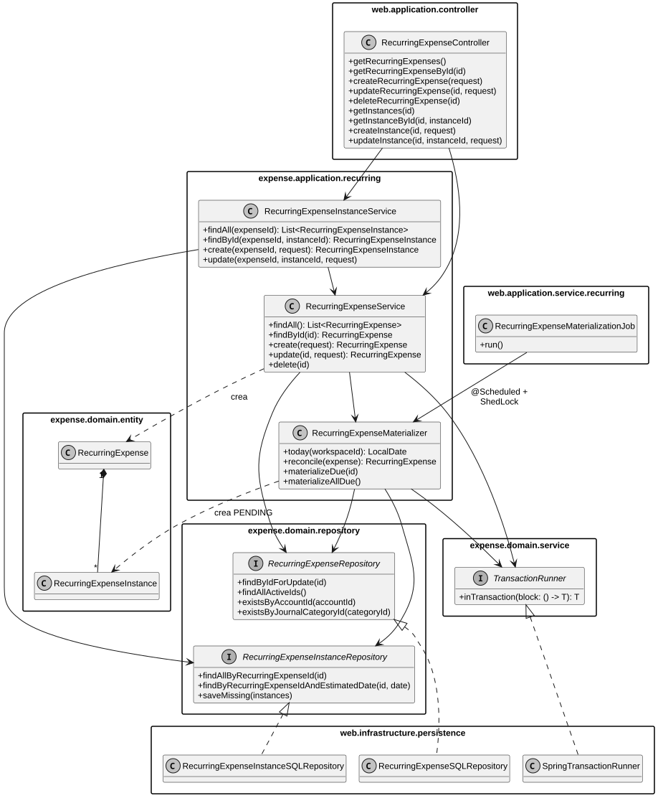

`RecurringExpenseController` expone el alta, la modificación, la baja y la consulta de gastos recurrentes y de sus ocurrencias, mediante `RecurringExpenseService` y `RecurringExpenseInstanceService`. `RecurringExpenseMaterializer` crea las ocurrencias pendientes: lo invoca `RecurringExpenseService` al crear o editar un gasto, y `RecurringExpenseMaterializationJob`, una tarea programada protegida con ShedLock, para las ocurrencias que vencen con el tiempo.

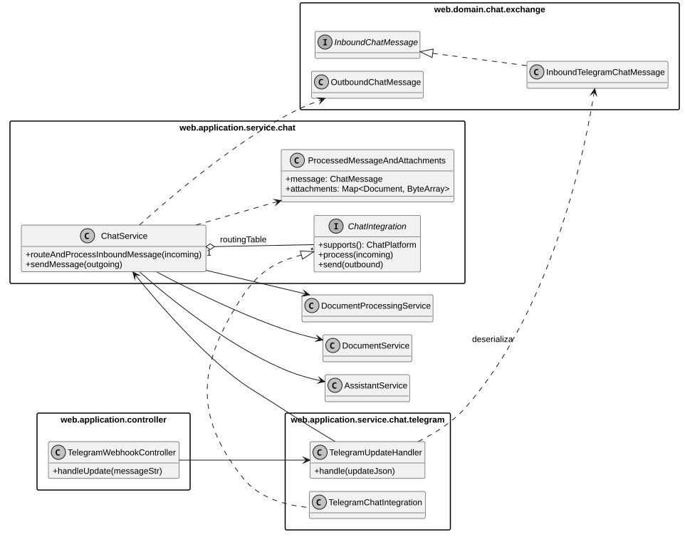

`TelegramWebhookController` entrega la actualización a `TelegramUpdateHandler`, que la convierte en un `InboundTelegramChatMessage` y la envía a `ChatService`. Este elige la `ChatIntegration` según la plataforma (hoy solo `TelegramChatIntegration`) y se apoya en `DocumentProcessingService`, `DocumentService` y `AssistantService` para procesar los adjuntos, guardarlos y obtener la respuesta del asistente.

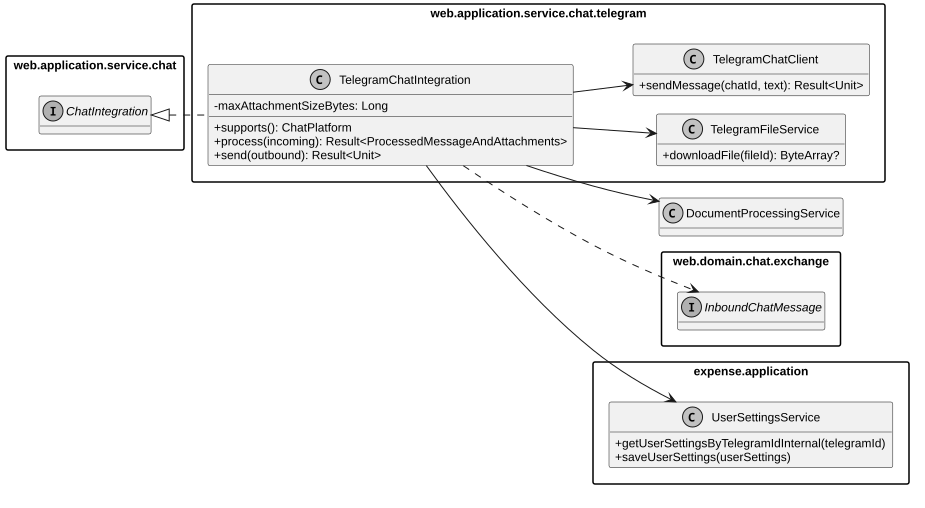

`TelegramChatIntegration` realiza `ChatIntegration`: identifica al usuario mediante `UserSettingsService`, descarga los adjuntos con `TelegramFileService`, los procesa con `DocumentProcessingService` y envía las respuestas con `TelegramChatClient`.

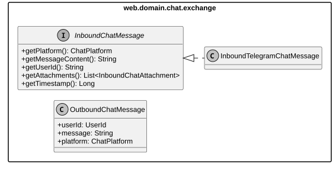

`InboundChatMessage` abstrae el mensaje recibido de cualquier plataforma y `InboundTelegramChatMessage` lo realiza para Telegram; `OutboundChatMessage` representa el mensaje que se envía al usuario.

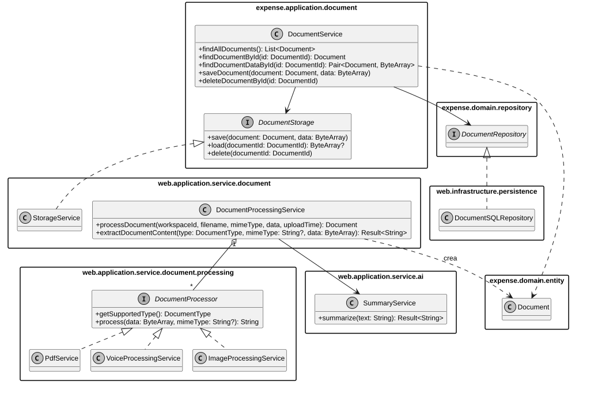

`DocumentProcessingService` selecciona un `DocumentProcessor` según el tipo de documento: `PdfService` (PDF), `VoiceProcessingService` (audio) o `ImageProcessingService` (imagen); luego obtiene un resumen con `SummaryService`. `DocumentService` guarda los metadatos mediante `DocumentRepository` y los archivos mediante `DocumentStorage`, que `StorageService` realiza sobre almacenamiento compatible con S3.

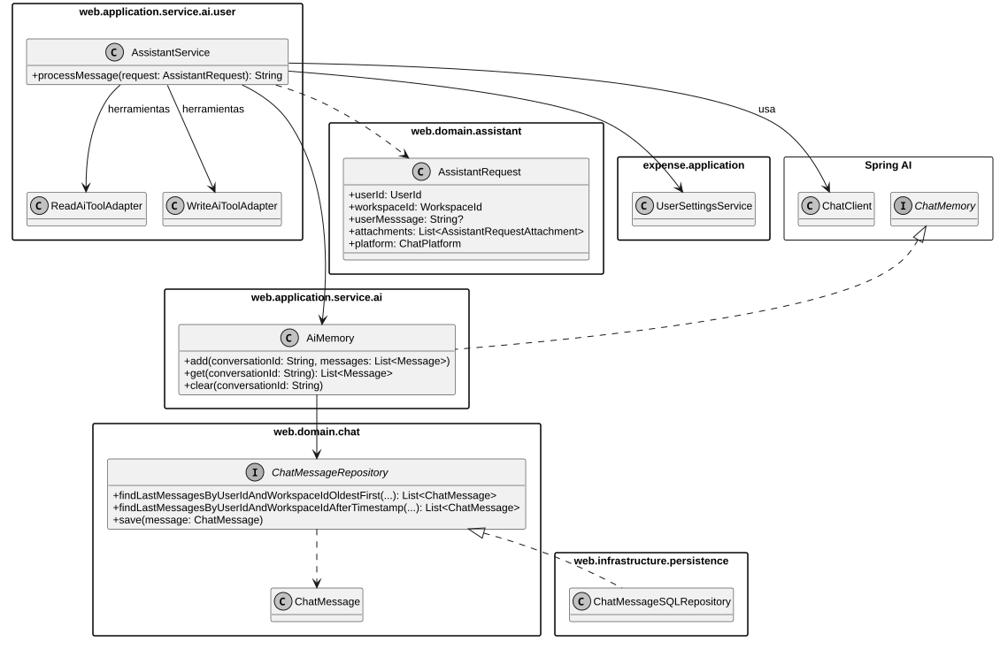{.apaisada}

`AssistantService` envía el mensaje del usuario al modelo mediante un `ChatClient` de Spring AI. La memoria de la conversación la resuelve `AiMemory`, que realiza `ChatMemory` y guarda los mensajes mediante `ChatMessageRepository`. El asistente dispone de herramientas de lectura (`ReadAiToolAdapter`) y de escritura (`WriteAiToolAdapter`); en modo de solo lectura solo usa las primeras.

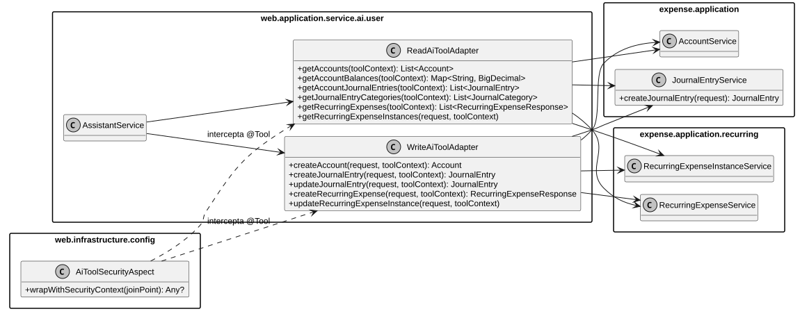{.apaisada}

Las herramientas de lectura y escritura invocan los servicios de aplicación (por ejemplo, `JournalEntryService.createJournalEntry`), de modo que el registro de un movimiento desde el chatbot reutiliza el mismo caso de uso que la aplicación web. `AiToolSecurityAspect` intercepta cada método anotado con `@Tool` para establecer el usuario y el espacio de trabajo antes de ejecutarlo.
