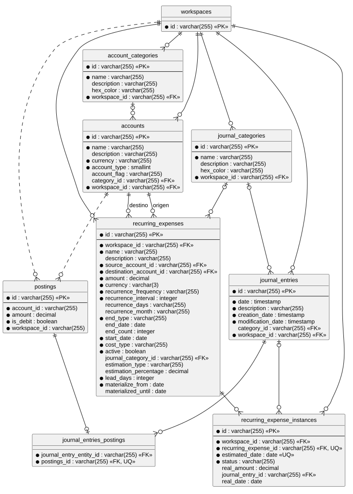
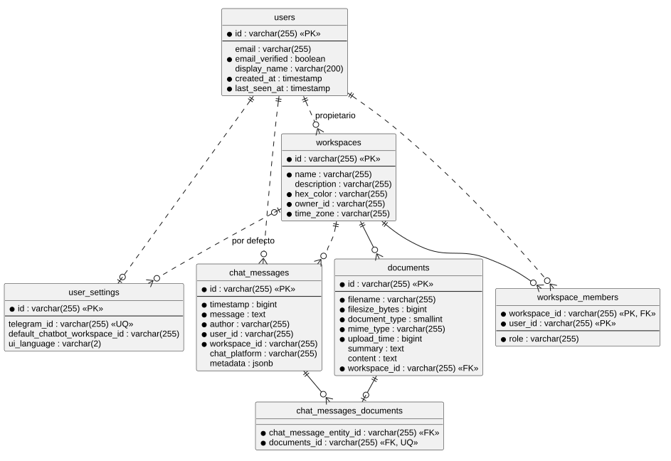

# 10.5.8 Diagrama Entidad Relación

> [!quote] Consigna
> [Descripción: Diagrama de entidad relación de la solución tecnológica. Incluir también el diccionario de datos del DER]

## Qué se espera

DER **y diccionario de datos** (tabla, campo, tipo, descripción, restricciones).

## Ideas y material disponible

- Criterio del profesor: el diagrama se hace sobre los 4 casos de uso core (ver [[10.5.3 Casos de uso]]).
- Guardar los diagramas exportados en `imagenes/` (por ejemplo, desde PlantUML, Mermaid o draw.io, conservando también el archivo fuente).
- Tablas actuales (Liquibase): `users`, `user_settings`, `workspaces`, `workspace_members`, `accounts`, `account_categories`, `categories`, `journal_entries`, `postings`, `journal_entries_postings`, `documents`, `chat_messages`, `chat_messages_documents`.

## Ejemplos

- Diccionario: Tabla | Campo | Tipo | Nulo | Clave | Descripción.

## Preguntas abiertas y observaciones

- Diagramas derivados del código al 13/11/2026.
- Tabla `users` y `user_settings` actualizadas el 13/11/2026 según el cambio de usuarios en el código: `users` pasa a ser una copia local de la identidad de Keycloak (se eliminan `name`, `hashed_password` y la unicidad de `email`, que pasa a ser opcional; se agregan `email_verified`, `display_name`, `created_at` y `last_seen_at`) y `user_settings` pierde `email`. Tipos tomados de la migración `2026/11/14-01-changelog.sql` (14/11/2026; las fechas son `TIMESTAMP(6) WITHOUT TIME ZONE`).
- `last_seen_at` no se actualiza en cada solicitud: el filtro `AuthenticatedUserSyncFilter` solo escribe si cambió la identidad o pasó el intervalo `quickexpense.users.sync-interval` (6 horas por defecto).
- Faltan las tablas del caso de uso core 4 (CU-008-001), cuando esté implementado: el índice de inflación (IPC) y las alertas.

## Respuesta

<!-- Todo lo que esté debajo de este título es el texto que se compila al documento final. -->

El diagrama entidad relación se limita a las tablas que utilizan los casos de uso core implementados (CU-003-001, CU-002-001 y CU-005-001/002/003), según el criterio de la cátedra. Se deriva de las migraciones de Liquibase de la aplicación, aplicadas en orden. Las tablas del caso de uso core 4 (índice de inflación y alertas) se agregarán cuando esté implementado. Además, la base de datos incluye la tabla `shedlock`, infraestructura que evita que la tarea programada de generación de ocurrencias se ejecute simultáneamente en más de una instancia; no se incluye en el diagrama.

El primer diagrama muestra las tablas de cuentas, categorías, asientos, imputaciones y gastos recurrentes; `workspaces` aparece solo como referencia.

El segundo diagrama muestra las tablas de usuarios, configuración, espacios de trabajo, miembros, documentos y mensajes de chat.

Las líneas continuas representan claves foráneas definidas en la base de datos. Las líneas punteadas representan relaciones lógicas que la aplicación respeta, pero que no tienen una clave foránea en la base de datos (por ejemplo, `user_settings.id` con `users.id`, o `postings.account_id` con `accounts.id`).

Las tablas con datos de un espacio de trabajo incluyen la columna `workspace_id`. Las tablas `accounts`, `account_categories`, `journal_categories`, `journal_entries`, `postings`, `documents`, `recurring_expenses` y `recurring_expense_instances` están protegidas por políticas de seguridad a nivel de fila (Row-Level Security) de PostgreSQL, que limitan el acceso a las filas del espacio de trabajo actual. Las tablas `users`, `user_settings`, `workspaces`, `workspace_members`, `journal_entries_postings`, `chat_messages` y `chat_messages_documents` no tienen estas políticas.

### Diccionario de datos

En la columna Clave, PK indica clave primaria, FK clave foránea y UQ restricción de unicidad.

**Tabla `users`** — Copia local de la identidad de cada usuario en Keycloak. La aplicación no guarda contraseñas: la autenticación la resuelve Keycloak, y los datos de esta tabla se actualizan a partir del token de acceso con el que el usuario realiza cada solicitud.

| Campo | Tipo | Nulo | Clave | Descripción |
| ---------------------- | -------------------- | -------- | ------------ | ------------------------------ |
| `id` | VARCHAR(255) | No | PK | Identificador del usuario; coincide con el identificador (*subject*) del usuario en Keycloak |
| `email` | VARCHAR(255) | Sí |  | Correo electrónico informado por Keycloak |
| `email_verified` | BOOLEAN | No |  | Indica si Keycloak verificó el correo electrónico |
| `display_name` | VARCHAR(200) | Sí |  | Nombre para mostrar del usuario |
| `created_at` | TIMESTAMP | No |  | Momento en que el usuario utilizó la aplicación por primera vez |
| `last_seen_at` | TIMESTAMP | No |  | Momento de la última actualización de los datos del usuario |

**Tabla `user_settings`** — Configuración de cada usuario.

| Campo | Tipo | Nulo | Clave | Descripción |
| ---------------------- | -------------------- | -------- | ------------ | ------------------------------ |
| `id` | VARCHAR(255) | No | PK | Identificador del usuario al que pertenece la configuración (coincide con `users.id`) |
| `telegram_id` | VARCHAR(255) | Sí | UQ | Identificador de Telegram vinculado al usuario; no puede repetirse |
| `default_chatbot_workspace_id` | VARCHAR(255) | Sí |  | Identificador del espacio de trabajo en el que el chatbot registra los datos por defecto |
| `ui_language` | VARCHAR(2) | Sí |  | Código del idioma de la interfaz |

**Tabla `workspaces`** — Espacios de trabajo.

| Campo | Tipo | Nulo | Clave | Descripción |
| ---------------------- | -------------------- | -------- | ------------ | ------------------------------ |
| `id` | VARCHAR(255) | No | PK | Identificador del espacio de trabajo |
| `name` | VARCHAR(255) | No |  | Nombre del espacio de trabajo |
| `description` | VARCHAR(255) | Sí |  | Descripción del espacio de trabajo |
| `hex_color` | VARCHAR(255) | No |  | Color del espacio de trabajo en formato hexadecimal |
| `owner_id` | VARCHAR(255) | No |  | Identificador del usuario propietario del espacio de trabajo |
| `time_zone` | VARCHAR(255) | No |  | Zona horaria del espacio de trabajo (por defecto, `America/Argentina/Buenos_Aires`) |

**Tabla `workspace_members`** — Miembros de cada espacio de trabajo y su rol.

| Campo | Tipo | Nulo | Clave | Descripción |
| ---------------------- | -------------------- | -------- | ------------ | ------------------------------ |
| `workspace_id` | VARCHAR(255) | No | PK, FK → workspaces | Identificador del espacio de trabajo |
| `user_id` | VARCHAR(255) | No | PK | Identificador del usuario miembro |
| `role` | VARCHAR(255) | No |  | Rol del miembro en el espacio de trabajo (`READ_ONLY`, `MEMBER` o `ADMIN`) |

**Tabla `account_categories`** — Categorías de cuenta.

| Campo | Tipo | Nulo | Clave | Descripción |
| ---------------------- | -------------------- | -------- | ------------ | ------------------------------ |
| `id` | VARCHAR(255) | No | PK | Identificador de la categoría de cuenta |
| `name` | VARCHAR(255) | No |  | Nombre de la categoría |
| `description` | VARCHAR(255) | Sí |  | Descripción de la categoría |
| `hex_color` | VARCHAR(255) | Sí |  | Color de la categoría en formato hexadecimal |
| `workspace_id` | VARCHAR(255) | No | FK → workspaces | Espacio de trabajo al que pertenece la categoría |

**Tabla `accounts`** — Cuentas del espacio de trabajo.

| Campo | Tipo | Nulo | Clave | Descripción |
| ---------------------- | -------------------- | -------- | ------------ | ------------------------------ |
| `id` | VARCHAR(255) | No | PK | Identificador de la cuenta |
| `name` | VARCHAR(255) | No |  | Nombre de la cuenta |
| `description` | VARCHAR(255) | Sí |  | Descripción de la cuenta |
| `currency` | VARCHAR(255) | No | UQ (con `workspace_id` y `account_flag`) | Código de la moneda de la cuenta (por ejemplo, `ARS`) |
| `account_type` | SMALLINT | No |  | Tipo de cuenta, guardado como posición del enumerado: activo (0), pasivo (1), ingreso (2), gasto (3) o patrimonio neto (4) |
| `account_flag` | VARCHAR(255) | Sí | UQ (con `workspace_id` y `currency`) | Marca de cuenta especial del sistema (`INITIAL_BALANCE_SOURCE`) |
| `category_id` | VARCHAR(255) | Sí | FK → account_categories | Categoría de la cuenta |
| `workspace_id` | VARCHAR(255) | No | FK → workspaces | Espacio de trabajo al que pertenece la cuenta |

**Tabla `journal_categories`** — Categorías de movimiento (asiento).

| Campo | Tipo | Nulo | Clave | Descripción |
| ---------------------- | -------------------- | -------- | ------------ | ------------------------------ |
| `id` | VARCHAR(255) | No | PK | Identificador de la categoría de movimiento |
| `name` | VARCHAR(255) | No |  | Nombre de la categoría |
| `description` | VARCHAR(255) | Sí |  | Descripción de la categoría |
| `hex_color` | VARCHAR(255) | Sí |  | Color de la categoría en formato hexadecimal |
| `workspace_id` | VARCHAR(255) | No | FK → workspaces | Espacio de trabajo al que pertenece la categoría |

**Tabla `journal_entries`** — Asientos contables (movimientos).

| Campo | Tipo | Nulo | Clave | Descripción |
| ---------------------- | -------------------- | -------- | ------------ | ------------------------------ |
| `id` | VARCHAR(255) | No | PK | Identificador del asiento |
| `date` | TIMESTAMP | No |  | Fecha y hora del movimiento |
| `description` | VARCHAR(255) | No |  | Descripción del movimiento |
| `creation_date` | TIMESTAMP | No |  | Fecha y hora de creación del asiento |
| `modification_date` | TIMESTAMP | No |  | Fecha y hora de la última modificación del asiento |
| `category_id` | VARCHAR(255) | Sí | FK → journal_categories | Categoría del movimiento |
| `workspace_id` | VARCHAR(255) | No | FK → workspaces | Espacio de trabajo al que pertenece el asiento |

**Tabla `postings`** — Imputaciones de un asiento a una cuenta.

| Campo | Tipo | Nulo | Clave | Descripción |
| ---------------------- | -------------------- | -------- | ------------ | ------------------------------ |
| `id` | VARCHAR(255) | No | PK | Identificador de la imputación |
| `account_id` | VARCHAR(255) | No |  | Identificador de la cuenta imputada |
| `amount` | DECIMAL | No |  | Monto de la imputación; siempre positivo |
| `is_debit` | BOOLEAN | No |  | Indica si la imputación es al débito (verdadero) o al crédito (falso) |
| `workspace_id` | VARCHAR(255) | No |  | Espacio de trabajo al que pertenece la imputación |

**Tabla `journal_entries_postings`** — Tabla intermedia que asocia cada asiento con sus imputaciones.

| Campo | Tipo | Nulo | Clave | Descripción |
| ---------------------- | -------------------- | -------- | ------------ | ------------------------------ |
| `journal_entry_entity_id` | VARCHAR(255) | No | FK → journal_entries | Identificador del asiento |
| `postings_id` | VARCHAR(255) | No | FK → postings, UQ | Identificador de la imputación; cada imputación pertenece a un único asiento |

**Tabla `documents`** — Documentos adjuntos recibidos por el chatbot.

| Campo | Tipo | Nulo | Clave | Descripción |
| ---------------------- | -------------------- | -------- | ------------ | ------------------------------ |
| `id` | VARCHAR(255) | No | PK | Identificador del documento |
| `filename` | VARCHAR(255) | No |  | Nombre del archivo |
| `filesize_bytes` | BIGINT | No |  | Tamaño del archivo en bytes |
| `document_type` | SMALLINT | No |  | Tipo de documento, guardado como posición del enumerado: PDF (0), imagen (1), audio (2), planilla (3), texto (4) o desconocido (5) |
| `mime_type` | VARCHAR(255) | No |  | Tipo MIME del archivo |
| `upload_time` | BIGINT | No |  | Momento de la carga, en milisegundos desde el 1 de enero de 1970 |
| `summary` | TEXT | Sí |  | Resumen del contenido del documento |
| `content` | TEXT | Sí |  | Contenido extraído del documento (texto del PDF, transcripción del audio o descripción de la imagen) |
| `workspace_id` | VARCHAR(255) | No | FK → workspaces | Espacio de trabajo al que pertenece el documento |

**Tabla `chat_messages`** — Mensajes de la conversación entre el usuario y el asistente, que utiliza la memoria del asistente.

| Campo | Tipo | Nulo | Clave | Descripción |
| ---------------------- | -------------------- | -------- | ------------ | ------------------------------ |
| `id` | VARCHAR(255) | No | PK | Identificador del mensaje |
| `timestamp` | BIGINT | No |  | Momento del mensaje, en milisegundos desde el 1 de enero de 1970 |
| `message` | TEXT | No |  | Texto del mensaje |
| `author` | VARCHAR(255) | No |  | Autor del mensaje (`USER`, `ASSISTANT`, `SYSTEM` o `TOOL`) |
| `user_id` | VARCHAR(255) | No |  | Identificador del usuario de la conversación |
| `workspace_id` | VARCHAR(255) | No |  | Identificador del espacio de trabajo de la conversación |
| `chat_platform` | VARCHAR(255) | Sí |  | Plataforma de chat de origen (hoy, `TELEGRAM`) |
| `metadata` | JSONB | Sí |  | Metadatos del mensaje, como las llamadas a herramientas y sus respuestas |

**Tabla `chat_messages_documents`** — Tabla intermedia que asocia cada mensaje con sus documentos adjuntos.

| Campo | Tipo | Nulo | Clave | Descripción |
| ---------------------- | -------------------- | -------- | ------------ | ------------------------------ |
| `chat_message_entity_id` | VARCHAR(255) | No | FK → chat_messages | Identificador del mensaje |
| `documents_id` | VARCHAR(255) | No | FK → documents, UQ | Identificador del documento; cada documento se asocia a un único mensaje |

**Tabla `recurring_expenses`** — Gastos recurrentes.

| Campo | Tipo | Nulo | Clave | Descripción |
| ---------------------- | -------------------- | -------- | ------------ | ------------------------------ |
| `id` | VARCHAR(255) | No | PK | Identificador del gasto recurrente |
| `workspace_id` | VARCHAR(255) | No | FK → workspaces | Espacio de trabajo al que pertenece el gasto recurrente |
| `name` | VARCHAR(255) | No |  | Nombre del gasto recurrente |
| `description` | VARCHAR(255) | Sí |  | Descripción del gasto recurrente |
| `source_account_id` | VARCHAR(255) | No | FK → accounts | Cuenta de origen del pago (de activo o de pasivo) |
| `destination_account_id` | VARCHAR(255) | No | FK → accounts | Cuenta de destino del pago (de gasto) |
| `amount` | DECIMAL | No |  | Monto esperado de cada ocurrencia |
| `currency` | VARCHAR(3) | No |  | Código de la moneda del monto |
| `recurrence_frequency` | VARCHAR(255) | No |  | Unidad de la periodicidad (`DAYS`, `WEEKS`, `MONTHS` o `YEARS`) |
| `recurrence_interval` | INTEGER | No |  | Cada cuántas unidades de la periodicidad se repite el gasto |
| `recurrence_days` | VARCHAR(255) | Sí |  | Días del mes en que ocurre (lista separada por comas, o `LAST` para el último día); en la periodicidad anual, el día del mes |
| `recurrence_month` | VARCHAR(255) | Sí |  | Mes en que ocurre, en la periodicidad anual |
| `end_type` | VARCHAR(255) | No |  | Tipo de finalización (`NEVER`, `UNTIL` o `AFTER_OCCURRENCES`) |
| `end_date` | DATE | Sí |  | Fecha de finalización, si el tipo de finalización es `UNTIL` |
| `end_count` | INTEGER | Sí |  | Cantidad de ocurrencias, si el tipo de finalización es `AFTER_OCCURRENCES` |
| `start_date` | DATE | No |  | Fecha de inicio de la recurrencia |
| `cost_type` | VARCHAR(255) | No |  | Tipo de costo (`FIXED` o `VARIABLE`) |
| `active` | BOOLEAN | No |  | Indica si el gasto recurrente está activo |
| `journal_category_id` | VARCHAR(255) | Sí | FK → journal_categories | Categoría que reciben los movimientos asociados al gasto |
| `estimation_type` | VARCHAR(255) | Sí |  | Estrategia de estimación de los gastos de costo variable (`MATCH_PERCENTAGE`) |
| `estimation_percentage` | DECIMAL | Sí |  | Tolerancia porcentual sobre el monto esperado, en los gastos de costo variable |
| `lead_days` | INTEGER | No |  | Días de anticipación con que se crean las ocurrencias (por defecto, 0) |
| `materialize_from` | DATE | No |  | Fecha desde la cual se crean las ocurrencias (por defecto, la fecha actual) |
| `materialized_until` | DATE | Sí |  | Fecha hasta la cual ya se crearon las ocurrencias |

**Tabla `recurring_expense_instances`** — Ocurrencias (vencimientos) de los gastos recurrentes.

| Campo | Tipo | Nulo | Clave | Descripción |
| ---------------------- | -------------------- | -------- | ------------ | ------------------------------ |
| `id` | VARCHAR(255) | No | PK | Identificador de la ocurrencia |
| `workspace_id` | VARCHAR(255) | No | FK → workspaces | Espacio de trabajo al que pertenece la ocurrencia |
| `recurring_expense_id` | VARCHAR(255) | No | FK → recurring_expenses, UQ (con `estimated_date`) | Gasto recurrente al que pertenece; si se elimina el gasto, se eliminan sus ocurrencias |
| `estimated_date` | DATE | No | UQ (con `recurring_expense_id`) | Fecha estimada del vencimiento |
| `status` | VARCHAR(255) | No |  | Estado de la ocurrencia (`PENDING`, `CONFIRMED` o `SKIPPED`) |
| `real_amount` | DECIMAL | Sí |  | Monto real pagado, en las ocurrencias confirmadas |
| `journal_entry_id` | VARCHAR(255) | Sí | FK → journal_entries | Asiento que registra el pago real; si se elimina el asiento, queda sin valor |
| `real_date` | DATE | Sí |  | Fecha real del pago, en las ocurrencias confirmadas |
