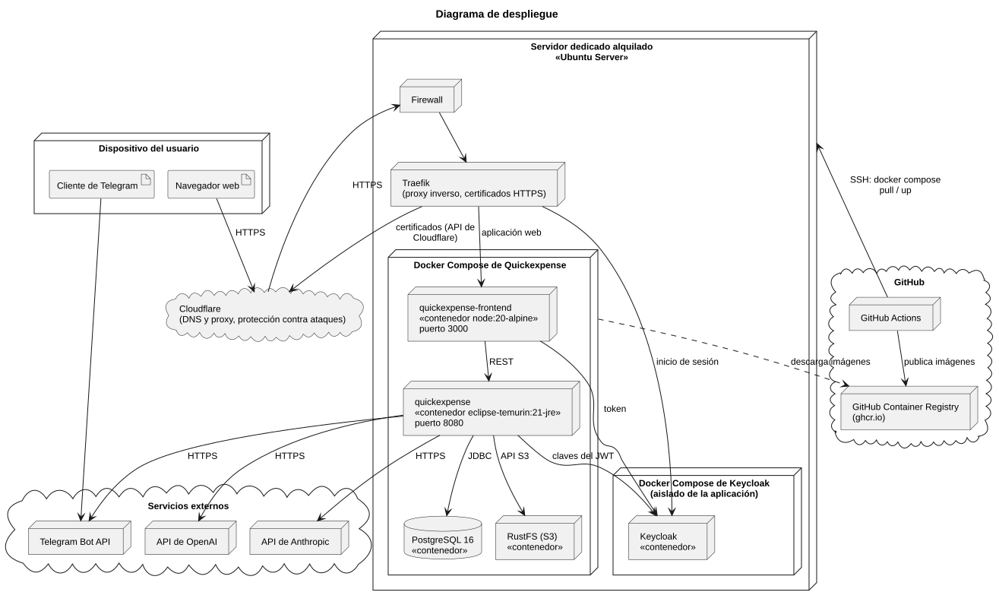

# 10.5.9 Diagrama de despliegue

> [!quote] Consigna
> [De ser necesario incluir el diagrama de despliegue de la solución]

## Qué se espera

Nodos físicos o de infraestructura y qué se despliega en cada uno.

## Ideas y material disponible

- Criterio del profesor: el diagrama se hace sobre los 4 casos de uso core (ver [[10.5.3 Casos de uso]]).
- Guardar los diagramas exportados en `imagenes/` (por ejemplo, desde PlantUML, Mermaid o draw.io, conservando también el archivo fuente).
- Del código: imágenes Docker del backend y el frontend publicadas en GitHub Container Registry; despliegue por SSH con docker compose en un servidor.

## Ejemplos

- (sin aportes por ahora)

## Preguntas abiertas y observaciones

- Diagrama derivado del código al 13/11/2026 (`imagenes/diagramas/despliegue.puml`): Dockerfiles, `.github/workflows/deploy-prod.yml` de los dos repositorios y lo confirmado por el autor (25/10/2026: toda la cadena corre en el servidor dedicado).
- Confirmado por el autor (13/11/2026): servidor con Ubuntu Server y firewall; Traefik como proxy inverso, que gestiona automáticamente los certificados HTTPS con Cloudflare; Cloudflare enruta el tráfico hacia la aplicación para prevenir ataques; Keycloak corre en el mismo servidor, en otro `docker compose`, y se trata como un servicio externo y aislado de la aplicación.
- Sin detallar en el diagrama: si Traefik corre como contenedor y en qué `docker compose`, y si el backend se publica a través de Traefik (por ejemplo, para el webhook de Telegram).
- Pendiente de agregar al diagrama cuando Quickexpense lo consuma: el API de indicadores (IPC y dólar) del autor, escrita en Go, que corre en el mismo servidor en otro `docker compose` (confirmado el 17/11/2026).

## Respuesta

<!-- Todo lo que esté debajo de este título es el texto que se compila al documento final. -->

Toda la solución se ejecuta en un único servidor dedicado alquilado, con Ubuntu Server y un *firewall*. El tráfico de los usuarios llega primero a Cloudflare, que lo enruta hacia el servidor y lo protege contra ataques. En el servidor, Traefik actúa como proxy inverso: recibe las solicitudes, las dirige al servicio que corresponde y gestiona automáticamente los certificados HTTPS con Cloudflare.

La aplicación corre en contenedores coordinados con Docker Compose: el *frontend*, el *backend*, PostgreSQL y el almacenamiento S3 (RustFS). Keycloak corre en el mismo servidor, pero en otro Docker Compose, y se trata como un servicio externo y aislado de la aplicación.

Cada cambio en la rama principal de los repositorios dispara un flujo de GitHub Actions. El flujo compila la aplicación, publica la imagen en GitHub Container Registry y se conecta por SSH al servidor para descargar la imagen nueva y reiniciar los servicios.

{.apaisada}
